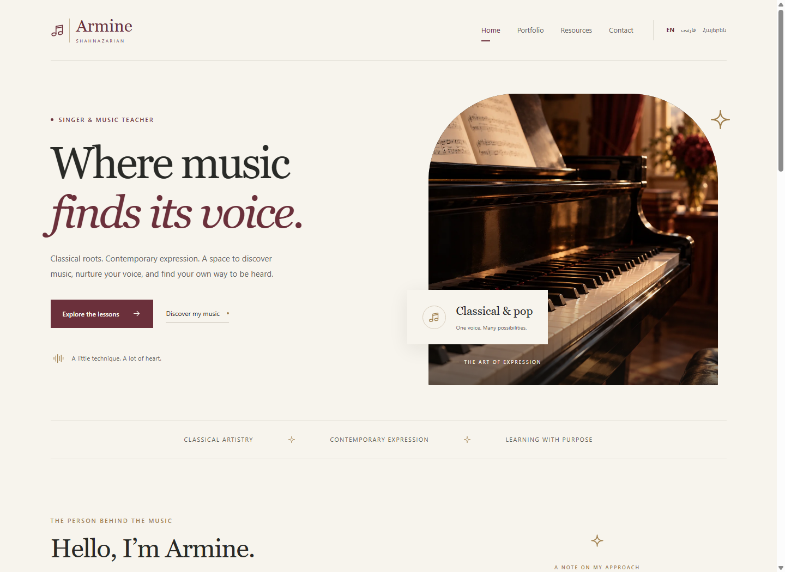
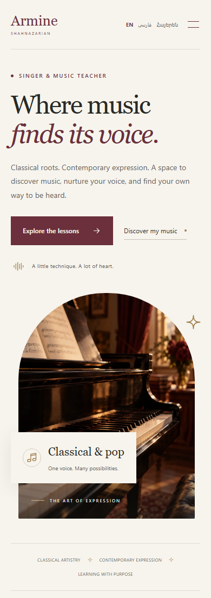
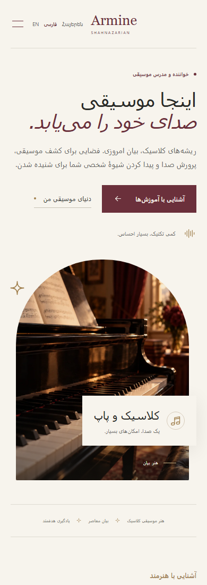
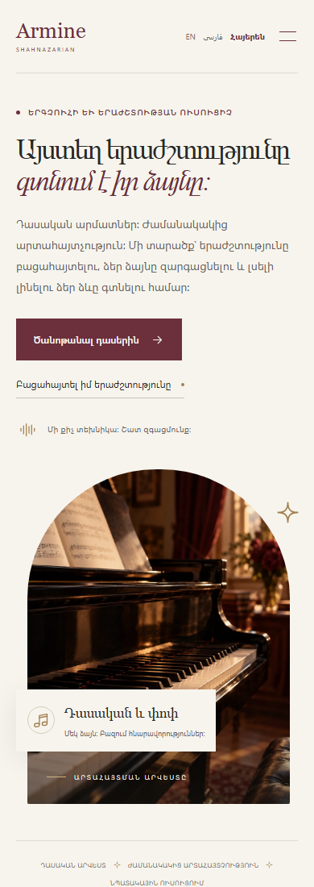
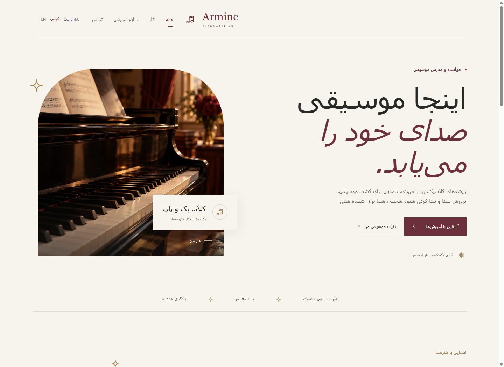
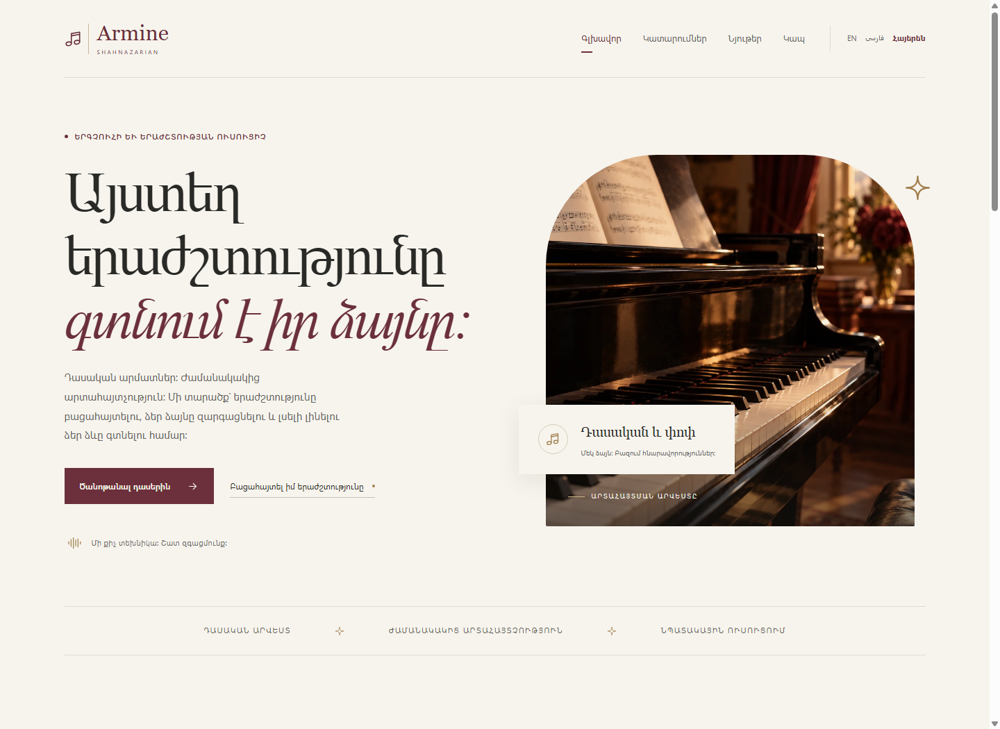

# Armine Shahnazarian

### Where music finds its voice.

An elegant, music-inspired portfolio for **Armine Shahnazarian**, a classical and pop singer and music teacher. Built with Astro and TypeScript, with a shared design in **English · فارسی · Հայերեն**.



[Preview gallery](#preview-gallery) · [Quick start](#quick-start) · [Project structure](#project-structure) · [Roadmap](#roadmap) · [Contributing](#contributing)

## About the project

A quiet, editorial design brings together an introduction to the artist, her musical approach, and lesson previews. Ivory backgrounds, burgundy accents, brass details, and piano imagery carry the visual identity across desktop and mobile.

- **Three languages:** separately rendered English, Farsi, and Armenian Home pages, with native-script language links and right-to-left Farsi layout.
- **Responsive layout:** a spacious desktop hero, stacked mobile content, and a compact mobile navigation menu.
- **Accessible foundations:** semantic HTML, translated accessible names, a keyboard skip link, and native expandable lesson details.
- **Lightweight delivery:** static Astro output, locally hosted imagery, system fonts, and minimal client JavaScript.

### Current status

**Home, About, Resources, and Contact are implemented in all three languages.** About includes a portfolio for uploaded videos and YouTube embeds; Resources supports downloadable PDF sheet music and playable/downloadable warmup audio. Media sections remain empty until authorized content is added. Contact details still need to be supplied.

English pages: `/`, `/about/`, `/resources/`, and `/contact/`. Add `/fa` or `/hy` before any route for Farsi or Armenian. The language switch preserves the current page.

To add videos, sheet music, or audio, see [Adding media](docs/adding-media.md). Files are managed in the repository and published with a rebuild; there is no browser upload area.

| Language | Local route | Direction |
| --- | --- | --- |
| English | `/` | Left to right |
| فارسی — Farsi | `/fa/` | Right to left |
| Հայերեն — Armenian | `/hy/` | Left to right |

## Preview gallery

Actual screenshots of the production build, captured at **1440 × 1050** on desktop and **390 × 1100** on mobile. Click an image to view it at its original size.

### Mobile · three languages

<table>
  <tr><th>English</th><th>فارسی</th><th>Հայերեն</th></tr>
  <tr>
    <td><a href="docs/screenshots/home-mobile.png"></a></td>
    <td><a href="docs/screenshots/home-farsi-mobile.png"></a></td>
    <td><a href="docs/screenshots/home-armenian-mobile.png"></a></td>
  </tr>
</table>

<details>
<summary><strong>View Farsi and Armenian desktop screenshots</strong></summary>

### فارسی · Farsi



### Հայերեն · Armenian



</details>

## Quick start

Use **Node.js 22.12.0 or newer** and npm. From the repository directory:

```sh
npm ci
npm run dev -- --background
```

Open [localhost:4321](http://localhost:4321). The translated pages are available at [/fa/](http://localhost:4321/fa/) and [/hy/](http://localhost:4321/hy/).

### Development commands

| Command | Purpose |
| --- | --- |
| `npm run dev -- --background` | Start the development server in the background |
| `npm run astro -- dev status` | Check the server status |
| `npm run astro -- dev logs` | Read development logs |
| `npm run astro -- dev stop` | Stop the development server |
| `npm run build` | Create the static production build in `dist/` |
| `npm run preview` | Serve the production build locally |

To inspect production output:

```sh
npm run build
npm run preview
```

## GitHub Pages deployment

This is an Astro project. GitHub Pages must deploy the built `dist/` directory through GitHub Actions; its default Jekyll build cannot parse `.astro` components.

1. Commit and push these changes to `master`, including `.github/workflows/deploy.yml`.
2. Open the repository's **Settings → Pages → Build and deployment** and set **Source** to **GitHub Actions**.
3. Open **Actions → Deploy Astro to GitHub Pages** and run the workflow if the push run has not already succeeded.

The workflow builds with npm and Node 24, uploads `dist/`, and deploys it to `https://shant-esmralda.github.io/armi-website/`. It runs on pushes to `master` and can also be run manually. No personal access token is required.

Local development uses `/`. The workflow supplies `--base /armi-website`; page links, language links, images, and local media use that base automatically. Keep media paths in `src/content/media.ts` written as `/media/...` without adding the repository name.

To verify the GitHub Pages layout locally:

```sh
npm run build -- --base /armi-website
npm run preview -- --base /armi-website
```

Open `http://localhost:4321/armi-website/`. For a future custom domain, update `site` in `astro.config.mjs` and remove the `--base /armi-website` argument from the workflow.

See the [Astro GitHub Pages guide](https://docs.astro.build/en/guides/deploy/github/) for the deployment and Pages source settings.

## Project structure

```text
src/
├── pages/
│   ├── index.astro          # English Home
│   └── [lang]/index.astro   # Farsi and Armenian Home
├── components/
│   ├── HomePage.astro       # Shared Home content
│   └── Icon.astro           # Reusable icons
├── layouts/
│   └── Layout.astro         # Document, metadata, navigation, footer
├── i18n/
│   └── home.ts              # Artist identity and translated copy
└── styles/
    └── global.css           # Shared responsive styling
public/
└── images/
    └── piano-hero.webp      # Optimized, locally hosted hero image
docs/
├── screenshots/            # Desktop and mobile repository previews
└── image-provenance.md      # Hero image origin and generation prompt
```

Edit content in [src/i18n/home.ts](src/i18n/home.ts), page markup in [src/components/HomePage.astro](src/components/HomePage.astro), and styling in [src/styles/global.css](src/styles/global.css). Keep content, navigation, metadata, and accessible names consistent across all three languages.

## Roadmap

- [x] Home page in English, Farsi, and Armenian
- [x] Responsive design and language navigation
- [x] Farsi right-to-left layout
- [x] About page with a performance-video portfolio
- [x] Resources page supporting sheet music and practice audio
- [x] Dedicated Contact page
- [ ] Add owner-approved recordings, student materials, and contact details
- [ ] Artist review of the biography and translated copy before publication

## Contributing

Follow [AGENTS.md](AGENTS.md) for repository conventions. Use npm, preserve `package-lock.json`, and keep shared markup and translations in their existing locations. Consult the linked Astro documentation in the guidelines before changing routing, components, styling, or localization.

Before submitting changes:

1. Run `npm run build` and inspect the result with `npm run preview`.
2. Inspect all three languages on desktop and mobile.
3. Check keyboard navigation, language links, Farsi direction, image loading, and horizontal overflow.
4. Include desktop and mobile screenshots with visual changes.

No test framework, formatter, or linter is currently configured. Screenshot capture for this README confirmed image loading, language routes, correct document direction, the keyboard skip link, and no horizontal overflow at both viewport sizes in all three languages.

## Media and content

Publish only media and sheet music the owner is authorized to distribute. Credentials, testimonials, contact details, recordings, and downloadable materials must come from the owner.

The piano hero is **AI-generated illustrative imagery**, not a photograph of the artist’s actual studio. Its full generation prompt is preserved in [docs/image-provenance.md](docs/image-provenance.md).
